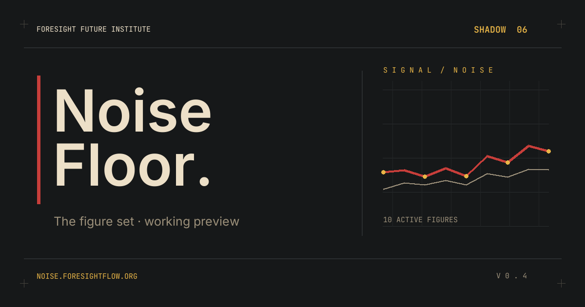

# Noise Floor

**Shadow 06 · Foresight Future Institute**

Data, figures and source references for *Noise Floor — The Output Without an Author*.

**Read the issue:** [noise.foresightflow.org](https://noise.foresightflow.org/) · [Full report (PDF)](https://noise.foresightflow.org/shadow06-noise-floor.pdf)

[Figures](#figures) · [Sources and scope](#sources-and-scope) · [Rebuild and check](#rebuild-and-check) · [Corrections](#corrections)

This repository contains the ten figures used across the issue's seven chapters. Each figure has a source CSV, a light SVG, a dark SVG and a vector PDF. Figures F4, F6, F7 and F8 also have an accessible HTML table. These files are the current input snapshots for the edition with a stated record close of **18 October 2026, 23:59 (UTC+4)**.

## Figures

| Figure | In the issue | Data | Exports |
|:--|:--|:--|:--|
| [F1 · Signs of AI authorship by web domain, 2021–2026](figures/F1.svg) | Ch 1.1 | [CSV](shadow06-figdata/F1_pew_domain_share.csv) | [Dark SVG](figures/F1.dark.svg) · [PDF](figures/F1.pdf) |
| [F2 · Music: reported upload share and stream share](figures/F2.svg) | Ch 1.2 | [CSV](shadow06-figdata/F2_deezer_uploads_vs_streams.csv) | [Dark SVG](figures/F2.dark.svg) · [PDF](figures/F2.pdf) |
| [F3 · arXiv monthly submissions](figures/F3.svg) | Ch 1.5 | [CSV](shadow06-figdata/F3_arxiv_submissions.csv) | [Dark SVG](figures/F3.dark.svg) · [PDF](figures/F3.pdf) |
| [F4 · Counting, screening, judging](figures/F4.svg) | Ch 2 | [CSV](shadow06-figdata/F4_institutions_decisions.csv) | [Dark SVG](figures/F4.dark.svg) · [PDF](figures/F4.pdf) · [HTML table](figures/F4.table.html) |
| [F5 · 1.5 million registrations, 17,000 owners](figures/F5.svg) | Ch 2.7 | [CSV](shadow06-figdata/F5_moltbook.csv) | [Dark SVG](figures/F5.dark.svg) · [PDF](figures/F5.pdf) |
| [F6 · Providers, one table](figures/F6.svg) | Ch 3.2 | [CSV](shadow06-figdata/F6_providers.csv) · [source list](shadow06-figdata/F6_sources.csv) | [Dark SVG](figures/F6.dark.svg) · [PDF](figures/F6.pdf) · [HTML table](figures/F6.table.html) |
| [F7 · Who must mark what](figures/F7.svg) | Ch 4 | [CSV](shadow06-figdata/F7_obligations.csv) | [Dark SVG](figures/F7.dark.svg) · [PDF](figures/F7.pdf) · [HTML table](figures/F7.table.html) |
| [F8 · Different samples, periods and units](figures/F8.svg) | Ch 5.4 | [CSV](shadow06-figdata/F8_vendor_methods.csv) | [Dark SVG](figures/F8.dark.svg) · [PDF](figures/F8.pdf) · [HTML table](figures/F8.table.html) |
| [F9 · Practice versus exam](figures/F9.svg) | Ch 6.1 | [CSV](shadow06-figdata/F9_learning_study.csv) | [Dark SVG](figures/F9.dark.svg) · [PDF](figures/F9.pdf) |
| [F10 · UK undergraduates and AI, 2024–2026](figures/F10.svg) | Ch 6.3 | [CSV](shadow06-figdata/F10_hepi.csv) | [Dark SVG](figures/F10.dark.svg) · [PDF](figures/F10.pdf) |

The figure titles above link to the light SVGs. The [reference register](REFERENCES.md) gives the source trail for each figure; the [check report](figures/CHECK.md) records what was read back from the exports.

## Sources and scope

The CSVs are fixed input snapshots, with source names and dates where the source supplies them. The figures preserve distinctions that matter when interpreting the numbers:

- F1 contains detector estimates for sampled web pages, not confirmed authorship of individual pages.
- F2 and F8 report platform or vendor measurements with different units, samples and periods. They are not a combined estimate.
- F5 counts registrations and owner records, not active or autonomous agents.
- F7 places binding rules, sector measures and guidance in separate groups. Rows marked `located, not cleared` identify a source record without describing an obligation.
- Empty cells in F9 and F10 are intentional; the source does not supply a comparable value for those positions.

The [reference register](REFERENCES.md) links the underlying publications and explains source limitations. A source link identifies where a statement came from; it does not turn a company's estimate or a detector output into independent validation. The figures and tables should be read with their captions and source notes.

## Rebuild and check

The generator reads only checked-in CSVs and fonts. After installing the Python dependencies, rendering and checking run offline from the repository root:

```sh
python3 -m venv .venv
source .venv/bin/activate
python3 -m pip install -r requirements.txt
python3 figures/render.py
python3 figures/check.py
```

[`figures/render.py`](figures/render.py) produces the SVG, PDF and HTML exports. Individual entry points such as [`figures/F5.py`](figures/F5.py) rebuild one figure. [`figures/check.py`](figures/check.py) compares rendered values with the CSVs, checks selected exact text from [`figures/TEXT.md`](figures/TEXT.md), and writes [`figures/CHECK.md`](figures/CHECK.md). The check verifies export consistency; it does not independently audit the source claims. Bundled fonts and their licences are documented in [`figures/fonts/README.md`](figures/fonts/README.md).

## Corrections

For a correction to a figure, data row or source link, write to [info@foresightflow.org](mailto:info@foresightflow.org) and include the figure ID and the source in question.
